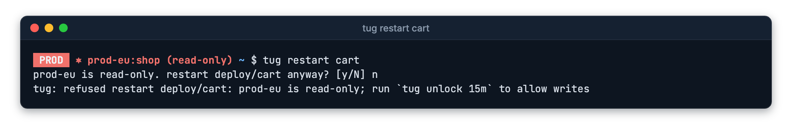

<p align="center">
  
</p>

<h1 align="center">tug</h1>

<p align="center">
  <strong>Every Kubernetes cluster you work with, one terminal at a time.</strong>
</p>

<p align="center">
  <a href="https://github.com/paingha/tugcli/releases/latest"></a>
  <a href="https://github.com/paingha/tugcli/actions/workflows/ci.yml"></a>
  <a href="https://paingha.github.io/tugcli/"></a>
  
  <a href="go.mod"></a>
  <a href="https://pkg.go.dev/github.com/paingha/tugcli/pkg/provider"></a>
  <a href="https://paingha.github.io/tugcli/docs/getting-started/installation"></a>
  <a href="LICENSE"></a>
</p>

tug finds your clusters wherever they live (kubeconfig files, kind and
minikube, EKS, GKE, AKS and more), keeps their credentials in your OS
keychain, and points each terminal at the cluster you choose. Your
`~/.kube/config` is never touched, production opens read-only, and kubectl,
helm and k9s follow along without any setup.

<p align="center">
  
</p>

<p align="center">
  <a href="https://paingha.github.io/tugcli/"><strong>User guide</strong></a> ·
  <a href="#install">Install</a> ·
  <a href="#get-started">Get started</a> ·
  <a href="#everyday-commands">Commands</a> ·
  <a href="#providers">Providers</a> ·
  <a href="CHANGELOG.md">Changelog</a>
</p>

## Why tug

- **All your clusters in one list.** `tug import` looks around your machine
  for kubeconfig files, local clusters and cloud sign-ins, and builds one
  catalog. Connect with part of a name: `tug connect prod`.
- **One cluster per terminal.** Each terminal has its own session, so
  switching in one tab never moves another.
- **No secrets on disk.** Tokens and keys live in the OS keychain, and the
  kubeconfigs tug writes hold none.
- **Production is read-only.** Clusters labelled `env=prod` ask before any
  change, and your prompt turns red so you always know where you are. Run
  `tug unlock 15m` when you mean it.
- **Answers, not just output.** `tug why api` says why a workload isn't
  ready and `tug doctor` says why a cluster can't be reached, each with what
  to do next.
- **Works with what you have.** Anything tug doesn't know runs as kubectl,
  so `tug get pods` just works.

## Install

tug is a single program for macOS, Linux and Windows, on amd64 and arm64.

**Homebrew** (macOS and Linux)

```bash
brew install --cask paingha/tap/tug
```

**Scoop** (Windows)

```powershell
scoop bucket add paingha https://github.com/paingha/scoop-bucket
scoop install paingha/tug
```

**Go** (1.26 or newer)

```bash
go install github.com/paingha/tugcli/cmd/tug@latest
```

**Download.** Get the archive for your platform from the
[latest release](https://github.com/paingha/tugcli/releases/latest), unpack
it and put `tug` on your `PATH`. Every release has signed checksums;
[Installation](https://paingha.github.io/tugcli/docs/getting-started/installation)
shows how to check them.

Already use [krew](https://krew.sigs.k8s.io/)? tug is also a kubectl plugin:
`kubectl krew index add tug https://github.com/paingha/krew-index`, then
`kubectl krew install tug/tug`, and run it as `kubectl tug`.

Check it worked with `tug version`. You'll also want
[kubectl](https://kubernetes.io/docs/tasks/tools/), which tug hands any
command it doesn't have.

## Get started

**1. Add the shell hook.** Add the line for your shell to the end of its
startup file, after any prompt theme such as Oh My Zsh or Starship, then open
a new terminal.

| Shell | Add this line | To |
| --- | --- | --- |
| zsh | `eval "$(tug init zsh)"` | `~/.zshrc` |
| bash | `eval "$(tug init bash)"` | `~/.bashrc` |
| fish | `tug init fish \| source` | `~/.config/fish/config.fish` |
| PowerShell | `Invoke-Expression (& tug init powershell \| Out-String)` | `$PROFILE` |

The hook gives each terminal its own session and shows its cluster in your
prompt. Can't use a hook? `tug shell` starts a subshell with a session
instead.

**2. Import your clusters.**

```bash
tug import
```

tug shows the accounts it finds and asks which to import:

```text
Found these accounts:
   1) kubeconfig/default  /Users/sam/.kube/config
   2) local/kind
   3) aws/work
Import which? [all, or numbers like 1,3; none to cancel]:
```

Your kubeconfig files stay exactly as they were; tug copies any tokens in
them to the keychain.

**3. Connect this terminal.**

```bash
tug ls                  # see your clusters
tug connect staging     # part of the name is enough
```

```text
Connected to staging-us, namespace default, read-write
```

Your prompt now starts with `⎈ staging-us:default`, and kubectl, helm and k9s
use that cluster in this terminal. Open another terminal and it's still
disconnected, ready for a different cluster.

The [quick start](https://paingha.github.io/tugcli/docs/getting-started/quick-start)
walks through this and the everyday commands in about five minutes.

## Everyday commands

Names are fuzzy: `api` finds `deploy/api-server`, and tug asks when more than
one thing matches. Add a kind to be exact, as in `sts/db` or `pod/debug`.

### Connect and look around

| Command | What it does |
| --- | --- |
| `tug connect prod` | Point this terminal at a cluster |
| `tug ns payments` | Switch namespace |
| `tug status` | Show this terminal's cluster, namespace and mode |
| `tug disconnect` | Go back to the `KUBECONFIG` you had before |
| `tug ui` | Open a full-screen view of clusters, workloads, logs and shells |
| `tug pick` | Fuzzy-pick an object, then run `why`, `tree`, `logs` or `pf` on it |

### Work with workloads

| Command | What it does |
| --- | --- |
| `tug logs api -f` | Follow logs from every pod, new ones too, with coloured prefixes |
| `tug sh api` | Open a shell in a pod, with a debug container for images that have none |
| `tug pf api 8080` | Port-forward by short name |
| `tug restart api` | Restart a workload; also `tug scale api 3` and `tug rollback api` |
| `tug top api` | Show CPU and memory per pod (needs metrics-server) |
| `tug get pods -A` | Run anything else as kubectl |

### Find out what's wrong

| Command | What it does |
| --- | --- |
| `tug why api` | Explain why it isn't ready: crashes, image pulls, probes, scheduling, volumes |
| `tug doctor` | Explain why a cluster can't be reached: DNS, TLS, credentials, clock, RBAC |
| `tug tree api` | Show what a workload owns, with the health of each part |
| `tug watch api --until ready` | Follow a rollout live, and exit when it's done |
| `tug support bundle api` | Collect a redacted archive to attach to a ticket |

### Stay safe

| Command | What it does |
| --- | --- |
| `tug unlock 15m` | Allow changes on a read-only cluster for 15 minutes |
| `tug lock` | Make it read-only again now |
| `tug connect prod --proxy` | Guard kubectl, helm and k9s too, not only tug's commands |
| `tug audit --since 24h` | List what tug let through and what it refused |

Every command has `--help`, and the
[command reference](https://paingha.github.io/tugcli/docs/reference/commands)
covers them all.

## Providers

A provider is somewhere tug can find clusters. Secrets a provider needs are
asked for once and kept in the keychain.

| Provider | Ships | What you need |
| --- | --- | --- |
| [Kubeconfig files](https://paingha.github.io/tugcli/docs/providers/kubeconfig) | built in | `~/.kube/config`, `$KUBECONFIG` or a file you name |
| [Local clusters](https://paingha.github.io/tugcli/docs/providers/local) | built in | kind, k3d, minikube, Docker Desktop, OrbStack or Rancher Desktop |
| [AWS EKS](https://paingha.github.io/tugcli/docs/providers/aws) | built in | an AWS profile (no AWS CLI needed) |
| [Google GKE](https://paingha.github.io/tugcli/docs/providers/google) | built in | a gcloud configuration or Application Default Credentials |
| [Azure AKS](https://paingha.github.io/tugcli/docs/providers/azure) | built in | an Azure sign-in, such as `az login` |
| [Cluster API](https://paingha.github.io/tugcli/docs/providers/capi) | built in | a management cluster already in tug |
| [Argo CD](https://paingha.github.io/tugcli/docs/providers/argocd) | built in | the cluster Argo CD runs in, already in tug |
| [ClusterProfile](https://paingha.github.io/tugcli/docs/providers/clusterprofile) | built in | a SIG Multicluster hub, already in tug |
| [Akamai LKE](https://paingha.github.io/tugcli/docs/providers/akamai) | plugin | a personal access token |
| [CoreWeave CKS](https://paingha.github.io/tugcli/docs/providers/coreweave) | plugin | an API access token |
| [Crusoe CMK](https://paingha.github.io/tugcli/docs/providers/crusoe) | plugin | an access key and secret key |
| [DigitalOcean DOKS](https://paingha.github.io/tugcli/docs/providers/digitalocean) | plugin | a personal access token |
| [Nebius mk8s](https://paingha.github.io/tugcli/docs/providers/nebius) | plugin | the `nebius` CLI, signed in |
| [Rancher](https://paingha.github.io/tugcli/docs/providers/rancher) | plugin | the server's URL and an API token |
| [Tailscale](https://paingha.github.io/tugcli/docs/providers/tailscale) | plugin | a tailnet running the Kubernetes operator |
| [Teleport](https://paingha.github.io/tugcli/docs/providers/teleport) | plugin | `tsh`, signed in |
| [Vultr VKE](https://paingha.github.io/tugcli/docs/providers/vultr) | plugin | an API key |

```bash
tug import aws --account work --set regions=eu-west-1
tug import google --account my-project
tug import kubeconfig ./downloaded.yaml   # its token moves to the keychain
```

Plugins are attached to every release. Install one with its checksum, here
using the [GitHub CLI](https://cli.github.com/):

```bash
gh release download --repo paingha/tugcli --pattern 'tug-provider-digitalocean_*' --pattern checksums.txt
tug plugin install tug-provider-digitalocean_*.tar.gz \
  --sha256 "$(grep tug-provider-digitalocean_ checksums.txt | cut -d' ' -f1)"
tug import digitalocean --account work    # asks for the token once
```

tug shows what a plugin may reach before it installs it, and runs plugins in
a sandbox with only the secrets they declare. Releases also include plugins
for Civo, Exoscale, IBM Cloud, IONOS, Omni, OpenShift, Oracle Cloud, OVHcloud
and Scaleway, which don't have guide pages yet; see [plugins/](plugins).
Need another platform?
[Write a plugin](https://paingha.github.io/tugcli/docs/plugins/writing) in
Go, Python or any language that reads and writes JSON.

## Going further

- **[Private clusters](https://paingha.github.io/tugcli/docs/guides/tunnels).**
  Reach an API server through an SSH jump host, a proxy, AWS SSM, Google IAP
  or Teleport: `tug tunnel set eks-private ssm://i-0123456789abcdef0`.
- **[The local proxy](https://paingha.github.io/tugcli/docs/guides/proxy).**
  `tug connect --proxy` sends kubectl, helm and k9s through tugd, a
  background process, so the read-only guard covers them too. tugd also keeps
  named port-forwards (`tug pf db 5432 --name db`) running when pods restart.
- **[Directory pins](https://paingha.github.io/tugcli/docs/guides/pins).** A
  `.tug.yaml` connects the terminal to the right cluster and namespace when
  you `cd` into a repository.
- **[Profiles](https://paingha.github.io/tugcli/docs/guides/profiles).** Save
  a cluster, namespace, safety mode, aliases and port-forwards together, then
  `tug profile up payments`.
- **[Team catalogs](https://paingha.github.io/tugcli/docs/guides/teams).**
  Share signed cluster names, labels and safety policies with your team.
  Credentials are never shared: everyone signs in as themselves.
- **[Many clusters at once](https://paingha.github.io/tugcli/docs/reference/commands#global-flags).**
  `tug get pods --cluster-selector env=staging` runs a read on every matching
  cluster, each line labelled with its cluster.
- **[Diffs and drift](https://paingha.github.io/tugcli/docs/guides/diff).**
  `tug diff -f k8s/` shows what an apply would change and who owns each
  field; `tug drift --against staging` compares two clusters.
- **[Policy checks](https://paingha.github.io/tugcli/docs/guides/policy).**
  `tug check` checks workloads against packs of rules, such as resource
  requests, probes, non-root and allowed registries.
- **[Controllers](https://paingha.github.io/tugcli/docs/guides/controllers)
  and [GitOps](https://paingha.github.io/tugcli/docs/guides/gitops).**
  `tug reconcile` and `tug gitops` explain what cert-manager, Flux, Argo CD
  and other controllers are doing, and where delivery fails.
- **[APIs and CRDs](https://paingha.github.io/tugcli/docs/guides/apis).**
  Search the resource types a cluster serves, read CRD schemas, and find
  deprecated API versions before an upgrade.
- **[Shortcuts](https://paingha.github.io/tugcli/docs/reference/commands/shortcuts).**
  Bookmarks, your own aliases, and `tug open deploy/api` to open the file
  that defines an object in your editor.
- **[Sign-in and rotation](https://paingha.github.io/tugcli/docs/guides/sign-in).**
  Sign in to OIDC clusters in the browser or with a device code, and rotate
  credentials with `tug auth rotate`.
- **[Settings](https://paingha.github.io/tugcli/docs/reference/commands/other#tug-settings).**
  Change tug's settings without editing `config.yaml`, as in
  `tug settings set sessions.maxAge 72h`. `tug settings list` shows them all,
  and tug asks before a change that would protect you less.
- **[AI explanations](https://paingha.github.io/tugcli/docs/guides/ai-explanations).**
  Opt in with `tug intelligence enable openai` (or Anthropic, Mistral, or any
  OpenAI-compatible API such as Ollama), then `tug why api --deep` has the
  model explain the evidence. tug shows you the evidence and the cost first.

## Status

tug is young and moving quickly. Until 1.0, a minor release may change
behaviour; [CHANGELOG.md](CHANGELOG.md) says what changed in each release and
how to upgrade.
[Uninstalling](https://paingha.github.io/tugcli/docs/getting-started/uninstalling)
shows how to remove tug and everything it stored.

## Getting help

- **Questions** are answered in the
  [FAQ](https://paingha.github.io/tugcli/docs/faq), or ask in
  [Issues](https://github.com/paingha/tugcli/issues/new/choose).
- **Bugs:** open an [issue](https://github.com/paingha/tugcli/issues/new/choose)
  with `tug version`, and `tug doctor -o json` if the problem is reaching a
  cluster. Remove addresses and account IDs before you paste.
- **Security problems:** please report them privately, as
  [SECURITY.md](SECURITY.md) describes, not in a public issue. The
  [security guide](https://paingha.github.io/tugcli/docs/concepts/security)
  explains what tug protects and where that protection stops.

## Contributing

Bug reports, docs fixes, plugins and pull requests are welcome.
[CONTRIBUTING.md](CONTRIBUTING.md) explains how to set up a development copy,
how the code is laid out, and how to get a change merged. Everyone taking
part follows the [code of conduct](CODE_OF_CONDUCT.md).

## License

tug is released under the [MIT License](LICENSE).
